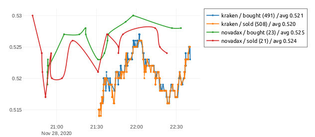

## Speculari

Speculari is a real-time market-data engine, written in Crystal, that watches order
books and trade history across multiple crypto exchanges at once — Binance, Kraken,
Bittrex, Braziliex, MercadoBitcoin, and NovaDax — and continuously compares them to
surface arbitrage opportunities. Every second it pulls each broker's order book and
recent trades, normalizes them into a shared `Order` model, and computes the spread
between the best ask on one exchange and the best bid on another for every coin the
two brokers have in common. The browser front end then lets you filter that stream by
minimum spread percentage and watch discrepancies — like the 2-hour XRP gap between
Kraken and MercadoBitcoin shown below — as they appear and close.

Crystal was a deliberate choice: a statically-typed, compiled language with Ruby-like
syntax, chosen specifically for the concurrency (lightweight fibers via `spawn`) and
raw throughput this workload needs — polling several exchange APIs in parallel,
every few seconds, without the runtime overhead of an interpreted language. It's the
same instinct behind [moeda.casa](https://moeda.casa) — picking the right tool for a
financial system where correctness and latency both matter — applied here to a
different problem: not moving money across a payment rail into crypto, but reading
and reconciling live market state across exchanges that were never designed to talk
to each other.

Together, moeda.casa and Speculari cover both halves of the same domain: one moves
real money (PIX, a blockchain) safely from one place to another, the other watches
prices across fragmented, uncoordinated venues to find where they disagree. Sample
output from the arbitrage view: [PDF](doc/speculari.sample.pdf), exported directly
from the browser.

